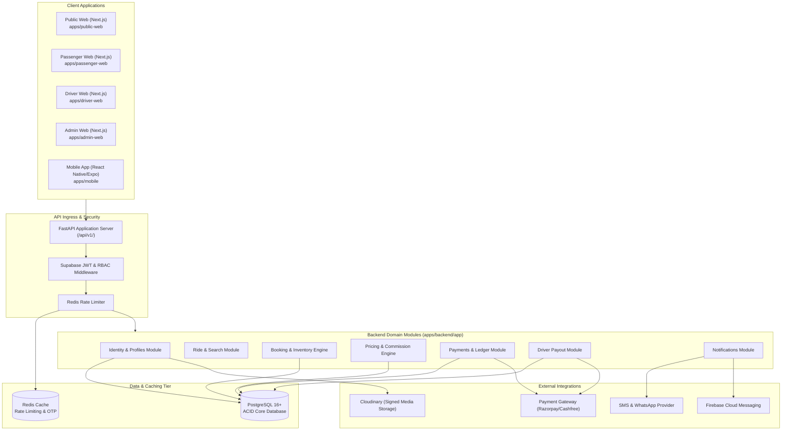

# Bidar Connect — System Architecture & Technical Specification

**Document Version:** 1.0.0  
**Status:** Approved Architectural Blueprint  
**Pattern:** Modular Monolith with Unified Multi-Client Distribution  
**API Prefix:** `/api/v1/`

---

## 1. Architectural Philosophy & Monolithic Boundaries

Bidar Connect adopts a **Modular Monolith** architecture. Distributed microservices are explicitly rejected for the initial production phase to eliminate network latency, distributed transaction complexity, and premature operational overhead.



---

## 2. Directory Layout & Layer Responsibilities

```
apps/backend/app/
├── api/
│   └── v1/                 # Thin HTTP controller endpoints (routing, schema validation)
│       ├── auth.py         # OTP & user session endpoints
│       ├── users.py        # Passenger & driver profiles
│       ├── vehicles.py     # Vehicle fleet & document uploads
│       ├── rides.py        # Ride publishing & search endpoints
│       ├── bookings.py     # Seat reservation & ticket retrieval
│       ├── payments.py     # Payment initiation & webhook receivers
│       ├── payouts.py      # Driver earnings & settlement endpoints
│       └── admin.py        # Operations, pricing, and audit endpoints
├── core/
│   ├── config.py           # Pydantic BaseSettings environment loader
│   ├── security.py         # Cryptographic helpers, JWT parsing, token claims
│   ├── exceptions.py       # Custom domain exceptions
│   └── logging.py          # Structured JSON request logging
├── database/
│   ├── session.py          # AsyncEngine & async_sessionmaker setup (asyncpg)
│   └── base.py             # SQLAlchemy DeclarativeBase
├── models/                 # SQLAlchemy 2.x ORM entity definitions
├── schemas/                # Pydantic v2 validation contracts & DTOs
├── services/               # Core business logic & cross-entity orchestrations
├── repositories/           # Encapsulated async database queries & transactions
├── integrations/           # Adapters for Supabase, Cloudinary, Maps, Gateway
└── modules/                # Self-contained domain modules
```

---

## 3. Standardized API Response & Envelope Specification

All endpoints in `/api/v1/` adhere to a consistent JSON response envelope. Clients can predictably deserialize responses regardless of the endpoint.

### 3.1 Standard Success Envelope
```json
{
  "success": true,
  "data": {
    "booking_id": "8f9a2b3c-4d5e-6f7a-8b9c-0d1e2f3a4b5c",
    "reference_code": "BC-202611-8932",
    "status": "CONFIRMED",
    "seat_count": 2,
    "total_fare": 620.00
  },
  "error": null,
  "metadata": {
    "timestamp": "2026-11-01T16:30:00.123Z",
    "request_id": "req_8819203a",
    "page": 1,
    "page_size": 20,
    "total_count": 1
  }
}
```

### 3.2 Standard Error Envelope
```json
{
  "success": false,
  "data": null,
  "error": {
    "code": "SEAT_INSUFFICIENT",
    "message": "Only 1 seat remains available for this ride, but 2 seats were requested.",
    "field": "seat_count",
    "details": {
      "requested_seats": 2,
      "available_seats": 1
    }
  },
  "metadata": {
    "timestamp": "2026-11-01T16:30:05.456Z",
    "request_id": "req_8819203b"
  }
}
```

---

## 4. Standardized Domain Error Codes

| Error Code | HTTP Status | Trigger Condition |
| :--- | :---: | :--- |
| `AUTHENTICATION_REQUIRED` | 401 | Missing or invalid Supabase JWT Bearer token |
| `ACCESS_DENIED` | 403 | Attempt to read/modify another user's private entity (IDOR protection) |
| `USER_SUSPENDED` | 403 | Account is restricted or suspended by Admin ops |
| `RESOURCE_NOT_FOUND` | 404 | Target ride, booking, or vehicle ID does not exist |
| `SEAT_INSUFFICIENT` | 409 | Requested seats exceed currently available inventory |
| `SEAT_LOCK_EXPIRED` | 410 | The 10-minute payment hold window expired before payment capture |
| `FARE_MODIFIED_UNAUTHORIZED`| 400 | Client attempted to override admin route pricing |
| `DOCUMENT_EXPIRED` | 422 | Attempt to publish a ride with expired insurance or licence |
| `INVALID_STATE_TRANSITION` | 422 | Disallowed status jump (e.g. `COMPLETED` → `CANCELLED`) |
| `IDEMPOTENCY_CONFLICT` | 409 | Request replayed with mismatched parameters under same key |
| `PAYMENT_SIGNATURE_INVALID` | 401 | Webhook HMAC verification failed |
| `RATE_LIMIT_EXCEEDED` | 429 | Exceeded OTP or API request threshold |
| `INTERNAL_SERVER_ERROR` | 500 | Unhandled exception (sanitized in production, full log in Sentry) |

---

## 5. Concurrency & Transaction Management Rules

1. **Explicit Transaction Blocks:** Any business workflow that modifies seat inventory or monetary balances must run inside an explicit transaction context:
   ```python
   async with db_session.begin():
       # All operations in this block are atomic
   ```
2. **Pessimistic Locking:** Seat reservations use `SELECT ... FOR UPDATE` exclusively. Optimistic locking with version columns is prohibited for seat holds due to high abort rates during peak morning booking rushes.
3. **Connection Pooling:** Configured with `asyncpg` connection pooling:
   - `pool_size: 20`
   - `max_overflow: 10`
   - `pool_timeout: 30` seconds
   - `pool_pre_ping: true` (reconnects dead connections)

