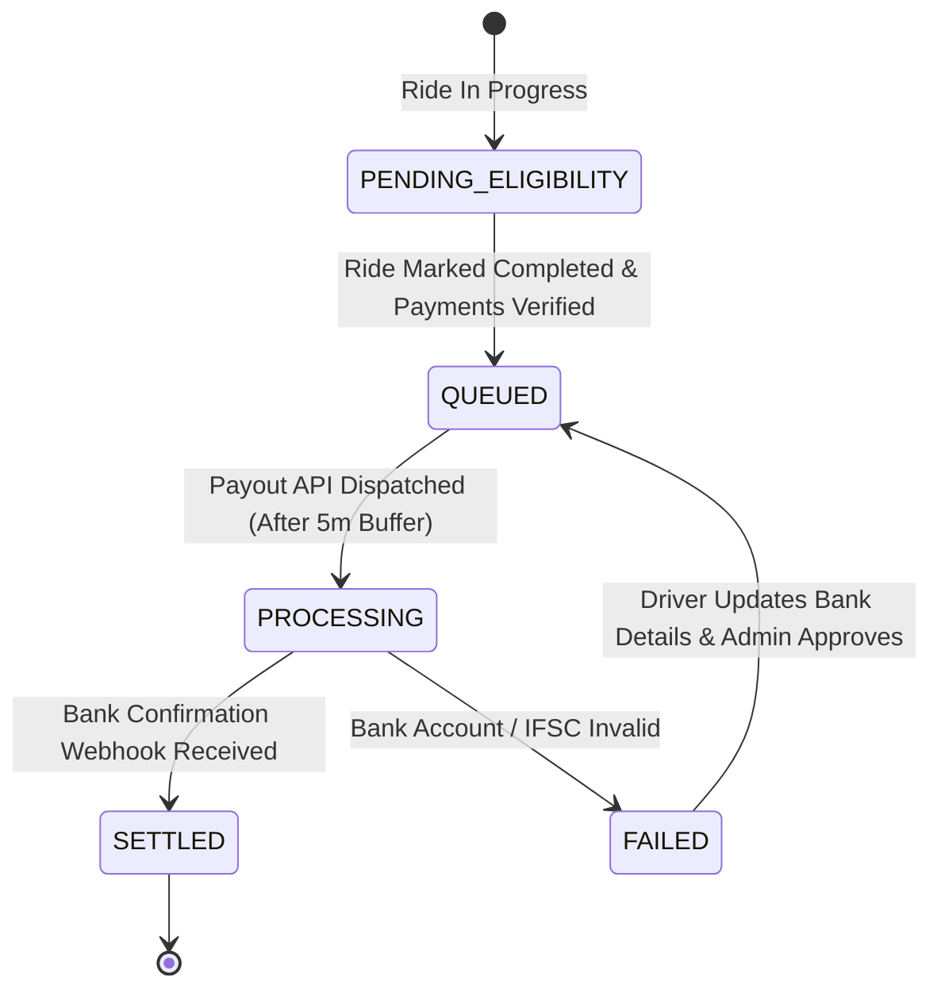

# Bidar Connect — Commission Model & Driver Payout Engine

**Document Version:** 1.0.0  
**Status:** Approved Technical Specification  
**Scope:** Commission formulas, immutable financial ledger, driver payout state machine, and settlement automation.

---

## 1. Commission Model Architecture

### 1.1 Commission Policy Engine
Platform commission is governed by a versioned rules engine in `commission_rules`:

```sql
CREATE TABLE commission_rules (
    id SERIAL PRIMARY KEY,
    rule_type VARCHAR(32) NOT NULL, -- 'FIXED_PER_SEAT', 'PERCENTAGE', 'TIERED'
    fixed_amount_per_seat NUMERIC(10, 2) DEFAULT 0.00,
    percentage_rate NUMERIC(5, 2) DEFAULT 0.00,
    effective_from TIMESTAMP WITH TIME ZONE NOT NULL,
    effective_to TIMESTAMP WITH TIME ZONE,
    is_active BOOLEAN DEFAULT TRUE,
    created_at TIMESTAMP WITH TIME ZONE DEFAULT NOW()
);
```

### 1.2 Mathematical Models
1. **Model A: Fixed Fee Per Booked Seat (Baseline Standard)**
   $$C = N_{\text{seats}} \times F_{\text{fixed}}$$
   *Example:* For $N = 2$ seats, with $F_{\text{fixed}} = ₹10$:
   $$C = 2 \times ₹10 = ₹20$$
   $$\text{Gross Fare} = 2 \times ₹310 = ₹620$$
   $$\text{Driver Payable} = ₹620 - ₹20 = ₹600$$

2. **Model B: Percentage Platform Commission**
   $$C = \text{Total Fare} \times \left(\frac{P}{100}\right)$$
   *Example:* For $P = 5\%$ on a ₹620 booking:
   $$C = ₹620 \times 0.05 = ₹31.00$$
   $$\text{Driver Payable} = ₹620 - ₹31 = ₹589.00$$

### 1.3 Snapshotting Rule
When a booking is confirmed, the system calculates $C$ based on the active commission rule and stores both `commission_rule_id` and `commission_amount` in `bookings`. Future administrative updates to commission rules do not affect existing confirmed bookings.

---

## 2. Double-Entry Immutable Financial Ledger

To guarantee auditability, financial transactions are recorded using double-entry bookkeeping principles. Records in `ledger_entries` are append-only; row deletion or in-place modification is prevented at the database trigger level.

### Ledger Account Types
- `PASSENGER_PAYABLE`: Temporary clearing for incoming passenger payments.
- `COMPANY_COMMISSION_REVENUE`: Platform earned revenue.
- `DRIVER_ESCROW_PAYABLE`: Funds held on behalf of drivers for completed trips.
- `PAYMENT_GATEWAY_FEES`: Merchant processing costs (typically 1.8% to 2.0%).
- `DRIVER_BANK_DISBURSEMENT`: Outgoing bank transfer settlement account.

### Transaction Journal Example (2 Seats Booked @ ₹310 each, Commission = ₹20)

| Entry ID | Transaction Type | Debit Account | Credit Account | Amount (INR) | Reference |
| :--- | :--- | :--- | :--- | :--- | :--- |
| `LED-101` | Passenger Payment | `PASSENGER_PAYABLE` | `DRIVER_ESCROW_PAYABLE` | ₹600.00 | `BK-8932` |
| `LED-102` | Platform Fee | `PASSENGER_PAYABLE` | `COMPANY_COMMISSION_REVENUE` | ₹20.00 | `BK-8932` |
| `LED-103` | Driver Settlement | `DRIVER_ESCROW_PAYABLE` | `DRIVER_BANK_DISBURSEMENT` | ₹600.00 | `PO-4412` |

---

## 3. Driver Payout Lifecycle & State Machine



### Detailed Execution Sequence
1. **Trip Arrival:** Driver taps "Ride Completed" in the Driver Portal.
2. **Eligibility Audit Engine:**
   - Validates that the journey route match was physically feasible (based on departure time and arrival timestamp).
   - Verifies that all booked passenger payments are in `CAPTURED` state.
   - Verifies that no passenger marked an emergency SOS or flagged a safety incident on the ride.
3. **Safety Hold Delay Window (Configurable Buffer):**
   - A mandatory holding period (default: 5 minutes; configurable up to 2 hours) counts down. This provides passengers time to report non-completion, driver no-shows, or passenger drop-off discrepancies.
4. **Disbursement Dispatch:**
   - The system queues the payout order to the driver's verified UPI ID or Bank Account (IMPS/NEFT via RazorpayX or Cashfree Payouts).
   - Status transitions to `PROCESSING`.
5. **Final Settlement Confirmation:**
   - **Critical Rule:** The payout is **never** marked `SETTLED` solely because a request was sent to the gateway.
   - Payout status transitions to `SETTLED` **only** upon receiving the asynchronous `payout.processed` webhook with the bank Reference UTR number.
   - If the transfer bounces (`payout.reversed` / `payout.failed`), the status transitions to `FAILED`, an alert is dispatched to the driver to correct banking details, and the funds remain protected in `DRIVER_ESCROW_PAYABLE`.
