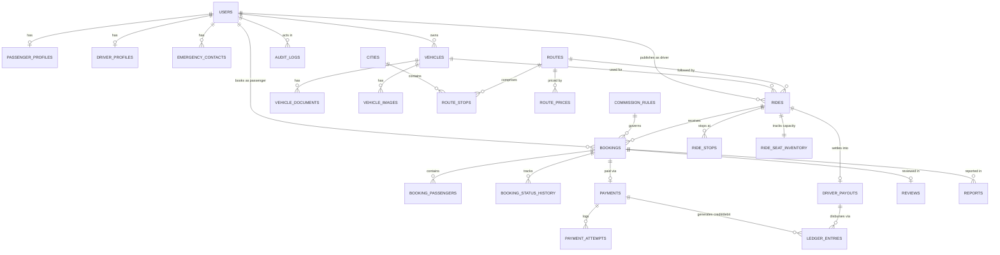

# Bidar Connect — Complete Database Architecture & ER Diagram

**Document Version:** 1.0.0  
**Status:** Approved Database Architecture  
**Database Engine:** PostgreSQL 16+  
**ORM & Migration Tooling:** SQLAlchemy 2.x (Async) + Alembic  
**Driver:** asyncpg (Production) / aiosqlite (Development / Unit Tests)  

---

## 1. Entity-Relationship Overview

---

## 2. Table Schemas, Constraints & Indexes

### 2.1 Identity Domain (`users`, `passenger_profiles`, `driver_profiles`, `emergency_contacts`)

#### `users`
- Primary user identity record supporting both passenger and driver roles simultaneously.
- Columns:
  - `id`: UUID (Primary Key, default `uuid7`/`gen_random_uuid()`)
  - `phone`: VARCHAR(20) (Unique, Not Null, Indexed)
  - `email`: VARCHAR(255) (Unique, Nullable)
  - `full_name`: VARCHAR(100) (Not Null)
  - `avatar_url`: VARCHAR(500) (Nullable, Cloudinary CDN)
  - `is_active`: BOOLEAN (Default `TRUE`)
  - `is_driver`: BOOLEAN (Default `FALSE`)
  - `is_passenger`: BOOLEAN (Default `TRUE`)
  - `is_admin`: BOOLEAN (Default `FALSE`)
  - `is_suspended`: BOOLEAN (Default `FALSE`)
  - `created_at`: TIMESTAMPTZ (Default `NOW()`)
  - `updated_at`: TIMESTAMPTZ (Default `NOW()`)
- Constraints:
  - `uq_users_phone`: UNIQUE (`phone`)
  - `ck_users_phone_format`: CHECK (`phone ~ '^\+91[0-9]{10}$'`)

#### `driver_profiles`
- Extended profile details for vehicle owners offering seats.
- Columns:
  - `id`: UUID (Primary Key)
  - `user_id`: UUID (Foreign Key `users.id` ON DELETE CASCADE, Unique)
  - `licence_number`: VARCHAR(50) (Unique, Not Null)
  - `licence_expiry`: DATE (Not Null, Indexed)
  - `licence_document_id`: VARCHAR(255) (Cloudinary restricted asset ID)
  - `is_verified`: BOOLEAN (Default `FALSE`)
  - `total_completed_trips`: INT (Default 0)
  - `average_rating`: NUMERIC(3, 2) (Default 5.00)
  - `payout_bank_account`: VARCHAR(50) (Encrypted/Masked)
  - `payout_ifsc`: VARCHAR(20)
  - `payout_upi_id`: VARCHAR(100)

#### `emergency_contacts`
- Columns:
  - `id`: UUID (Primary Key)
  - `user_id`: UUID (Foreign Key `users.id` ON DELETE CASCADE)
  - `name`: VARCHAR(100) (Not Null)
  - `phone`: VARCHAR(20) (Not Null)
  - `relationship`: VARCHAR(50) (Parent, Spouse, Sibling, Friend)

---

### 2.2 Vehicles & Compliance Domain (`vehicles`, `vehicle_documents`, `vehicle_images`)

#### `vehicles`
- Columns:
  - `id`: UUID (Primary Key)
  - `driver_id`: UUID (Foreign Key `users.id` ON DELETE RESTRICT, Indexed)
  - `make`: VARCHAR(50) (e.g. Maruti, Hyundai, Tata)
  - `model`: VARCHAR(50) (e.g. Dzire, Creta, Nexon)
  - `registration_number`: VARCHAR(20) (Unique, Not Null, Indexed, e.g. KA 38 M 1234)
  - `color`: VARCHAR(30) (Not Null)
  - `year`: INT (Not Null)
  - `fuel_type`: VARCHAR(20) (PETROL, DIESEL, CNG, EV)
  - `passenger_capacity`: INT (Default 4, Check `passenger_capacity BETWEEN 1 AND 6`)
  - `is_active`: BOOLEAN (Default `TRUE`)
  - `is_verified`: BOOLEAN (Default `FALSE`)

#### `vehicle_documents`
- Columns:
  - `id`: UUID (Primary Key)
  - `vehicle_id`: UUID (Foreign Key `vehicles.id` ON DELETE CASCADE)
  - `document_type`: VARCHAR(30) (RC, INSURANCE, PUC)
  - `document_number`: VARCHAR(100) (Nullable)
  - `cloudinary_public_id`: VARCHAR(255) (Not Null, Private/Authenticated mode)
  - `expiry_date`: DATE (Not Null, Indexed)
  - `is_valid`: BOOLEAN (Default `TRUE`)

---

### 2.3 Locations & Pricing Domain (`cities`, `routes`, `route_stops`, `route_prices`, `commission_rules`)

#### `cities`
- `id`: UUID (PK), `name`: VARCHAR(50) (Unique, Bidar, Hyderabad, Humnabad), `state`: VARCHAR(50)

#### `routes`
- `id`: UUID (PK), `origin_city_id`: UUID (FK `cities.id`), `destination_city_id`: UUID (FK `cities.id`), `distance_km`: INT

#### `route_prices`
- Administrative authoritative route seat pricing table.
- Columns:
  - `id`: UUID (Primary Key)
  - `route_id`: UUID (Foreign Key `routes.id`)
  - `origin_stop_name`: VARCHAR(100)
  - `destination_stop_name`: VARCHAR(100)
  - `fare_per_seat`: NUMERIC(10, 2) (Not Null, e.g. 310.00)
  - `currency`: VARCHAR(10) (Default 'INR')
  - `effective_from`: TIMESTAMPTZ (Not Null)
  - `effective_to`: TIMESTAMPTZ (Nullable)
  - `is_active`: BOOLEAN (Default `TRUE`)

#### `commission_rules`
- Versioned platform commission rules.
- Columns:
  - `id`: UUID (Primary Key)
  - `rule_code`: VARCHAR(50) (Unique, e.g. 'comm_v1_fixed')
  - `rule_type`: VARCHAR(30) (FIXED_PER_SEAT, PERCENTAGE, TIERED)
  - `fixed_amount_per_seat`: NUMERIC(10, 2) (Default 10.00)
  - `percentage_rate`: NUMERIC(5, 2) (Default 0.00)
  - `is_active`: BOOLEAN (Default `TRUE`)

---

### 2.4 Rides & Seat Inventory Domain (`rides`, `ride_stops`, `ride_seat_inventory`)

#### `rides`
- Columns:
  - `id`: UUID (Primary Key)
  - `driver_id`: UUID (FK `users.id`, Indexed)
  - `vehicle_id`: UUID (FK `vehicles.id`)
  - `route_id`: UUID (FK `routes.id`)
  - `departure_time`: TIMESTAMPTZ (Not Null, Indexed)
  - `estimated_arrival`: TIMESTAMPTZ
  - `status`: VARCHAR(30) (SCHEDULED, EN_ROUTE, TRIP_STARTED, ARRIVED, COMPLETED, CANCELLED)
  - `total_offered_seats`: INT (Not Null)
  - `fare_per_seat_snapshot`: NUMERIC(10, 2) (Snapshotted from `route_prices`)
  - `driver_notes`: TEXT

#### `ride_seat_inventory`
- **Crucial Atomic Inventory Table**
- Columns:
  - `id`: UUID (Primary Key)
  - `ride_id`: UUID (FK `rides.id` ON DELETE CASCADE, Unique, Indexed)
  - `total_capacity`: INT (Not Null)
  - `available_seats`: INT (Not Null, CHECK `available_seats >= 0`)
  - `reserved_seats`: INT (Default 0)
  - `version_lock`: INT (Default 1)

---

### 2.5 Bookings Domain (`bookings`, `booking_passengers`, `booking_status_history`)

#### `bookings`
- Columns:
  - `id`: UUID (Primary Key)
  - `reference_code`: VARCHAR(30) (Unique, Not Null, Indexed, e.g. `BC-202611-8932`)
  - `ride_id`: UUID (FK `rides.id`, Indexed)
  - `passenger_id`: UUID (FK `users.id`, Indexed)
  - `pickup_landmark`: VARCHAR(200) (Not Null)
  - `drop_landmark`: VARCHAR(200) (Not Null)
  - `seats_booked`: INT (Not Null, CHECK `seats_booked >= 1 AND seats_booked <= 6`)
  - `fare_per_seat`: NUMERIC(10, 2) (Snapshotted at creation)
  - `total_fare`: NUMERIC(10, 2) (Snapshotted: `seats_booked * fare_per_seat`)
  - `commission_amount`: NUMERIC(10, 2) (Snapshotted)
  - `driver_payable`: NUMERIC(10, 2) (Snapshotted: `total_fare - commission_amount`)
  - `commission_rule_id`: UUID (FK `commission_rules.id`)
  - `booking_status`: VARCHAR(30) (PENDING_PAYMENT, CONFIRMED, COMPLETED, CANCELLED, EXPIRED)
  - `reserved_until`: TIMESTAMPTZ (10-minute hold timestamp)
  - `idempotency_key`: VARCHAR(100) (Unique, Nullable)

---

### 2.6 Financial Ledger Domain (`payments`, `driver_payouts`, `ledger_entries`)

#### `payments`
- Columns:
  - `id`: UUID (Primary Key)
  - `booking_id`: UUID (FK `bookings.id`, Unique)
  - `gateway_order_id`: VARCHAR(100) (Indexed)
  - `gateway_payment_id`: VARCHAR(100) (Unique, Nullable)
  - `amount`: NUMERIC(10, 2) (Not Null)
  - `currency`: VARCHAR(10) (Default 'INR')
  - `status`: VARCHAR(30) (INITIATED, CAPTURED, FAILED, REFUNDED)
  - `captured_at`: TIMESTAMPTZ

#### `driver_payouts`
- Columns:
  - `id`: UUID (Primary Key)
  - `ride_id`: UUID (FK `rides.id`, Unique)
  - `driver_id`: UUID (FK `users.id`)
  - `gross_amount`: NUMERIC(10, 2)
  - `commission_deducted`: NUMERIC(10, 2)
  - `net_payable`: NUMERIC(10, 2)
  - `status`: VARCHAR(30) (PENDING_ELIGIBILITY, QUEUED, PROCESSING, SETTLED, FAILED)
  - `payout_reference_utr`: VARCHAR(100) (Bank transfer UTR)
  - `settled_at`: TIMESTAMPTZ

#### `ledger_entries`
- **Double-Entry Append-Only Immutable Accounting Table**
- Columns:
  - `id`: UUID (Primary Key)
  - `transaction_code`: VARCHAR(50) (e.g. `TXN-89234`)
  - `debit_account`: VARCHAR(50) (e.g. `PASSENGER_PAYABLE`, `DRIVER_ESCROW`)
  - `credit_account`: VARCHAR(50) (e.g. `COMPANY_COMMISSION_REVENUE`, `DRIVER_BANK_DISBURSEMENT`)
  - `amount`: NUMERIC(10, 2) (Not Null, CHECK `amount > 0`)
  - `currency`: VARCHAR(10) (Default 'INR')
  - `booking_id`: UUID (FK `bookings.id`, Nullable)
  - `payout_id`: UUID (FK `driver_payouts.id`, Nullable)
  - `recorded_at`: TIMESTAMPTZ (Default `NOW()`)

