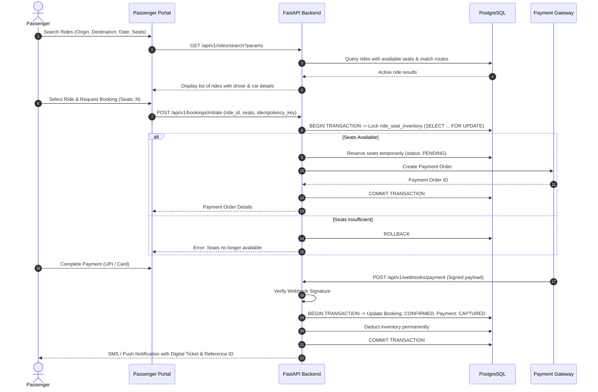
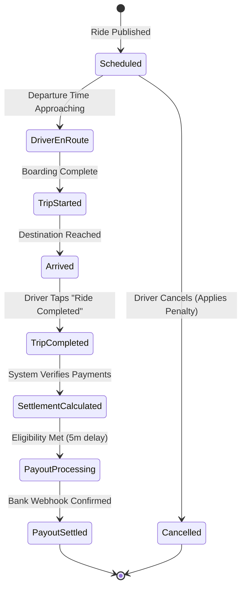

# Bidar Connect — Functional Requirements & User Journeys

**Document Version:** 1.0.0  
**Status:** Approved Baseline  
**Scope:** Complete functional specifications for Passenger, Driver, Admin, Public Web, and Mobile interfaces.

---

## 1. Passenger Functional Requirements

### 1.1 Authentication & Profile
- **FR-PAS-01 (OTP Registration/Login):** Users authenticate via Indian mobile numbers (`+91`). The backend validates phone format and generates an OTP through the SMS provider with Redis-backed rate limiting (maximum 3 requests per 10 minutes per IP/Phone).
- **FR-PAS-02 (Session Security):** On OTP verification, Supabase Auth issues a JWT session token. The backend validates token signature, audience, and extracts `user_id`.
- **FR-PAS-03 (Profile Management):** Passengers can update:
  - Full Name, Email, Profile Picture (uploaded to Cloudinary `user_profiles` folder).
  - Emergency Contacts (Name, Phone number, Relationship).
  - Optional Driving Details (if the user later chooses to offer rides).
- **FR-PAS-04 (Account Deletion Request):** In compliance with the DPDP Act, passengers can initiate an account deletion request. If no active upcoming bookings or unresolved disputes exist, the account is queued for soft-deletion and anonymization.

### 1.2 Ride Search & Filtering
- **FR-PAS-05 (Search Query):** Search takes mandatory fields:
  - Origin City (`Bidar` or `Hyderabad`).
  - Destination City (`Hyderabad` or `Bidar`).
  - Date of Travel (`YYYY-MM-DD`).
  - Required Seats (`1` to `6`).
- **FR-PAS-06 (Pickup and Drop Waypoints):** Search supports intermediate boarding and deboarding points:
  - *Bidar Points:* New Bus Stand, Mailoor Cross, Shivaji Chowk, Humnabad Ring Road.
  - *Hyderabad Points:* Miyapur Cross Roads, Kukatpally, Gachibowli, Secunderabad Station, Lakdikapul, RGIA Airport.
- **FR-PAS-07 (Search Filters):**
  - Departure Time Windows: Morning (05:00 - 11:59), Afternoon (12:00 - 16:59), Evening/Night (17:00 - 23:59).
  - Vehicle Type: Sedan, SUV, Hatchback.
  - Driver Gender / Women-Only preference (future-ready filter).
  - Luggage Capacity allowance (Small bag, Medium suitcase).
- **FR-PAS-08 (Sorting):** Sort by Departure Time (Ascending) and Fare per Seat (Ascending).

### 1.3 Booking & Checkout
- **FR-PAS-09 (Fare Snapshot):** When a passenger views checkout, the backend calculates:
  $$\text{Total Fare} = \text{Seat Count} \times \text{Admin Snapshotted Route Fare}$$
  The fare displayed is guaranteed for 10 minutes while payment is pending.
- **FR-PAS-10 (Instant Confirmation):** Upon successful payment confirmation via verified gateway webhook:
  - Booking transitions to `CONFIRMED`.
  - Seats in `ride_seat_inventory` are marked `RESERVED`.
  - A unique, human-readable Booking Reference is generated (e.g., `BC-202611-8932`).
  - An instant booking confirmation is sent via SMS, Push, and WhatsApp notification.
- **FR-PAS-11 (No Driver Rejection):** Confirmed bookings are immediately binding. The driver portal displays the passenger manifest with no option to reject confirmed travelers.

### 1.4 Booking Lifecycle & Post-Journey
- **FR-PAS-12 (Driver Contact Disclosure):** Driver phone number and vehicle registration plate are revealed to the passenger **only after** booking confirmation.
- **FR-PAS-13 (Emergency Journey Sharing):** Passengers can generate a secure, tokenized journey sharing web link (`/track/[token]`) that displays the vehicle's model, color, registration number, route, and driver details for their emergency contacts without requiring an account.
- **FR-PAS-14 (Cancellation & Automated Refund):**
  - Cancellation > 2 hours prior to departure: 100% refund of fare minus payment gateway processing fee.
  - Cancellation < 2 hours prior to departure: 50% refund to protect driver travel compensation.
  - Driver-initiated cancellation: 100% full refund to passenger + high-priority notification to find alternative rides.
- **FR-PAS-15 (Driver Reviews & Ratings):** Only passengers who completed a trip can submit a rating (1 to 5 stars) and select predefined tags (`Punctual`, `Safe Driving`, `Clean Car`, `Polite`).
- **FR-PAS-16 (Dispute / Safety Report):** Passengers can lodge a report directly against a trip. Critical safety reports immediately alert Admin ops.

---

## 2. Driver Functional Requirements

### 2.1 Driver Onboarding & Vehicle Management
- **FR-DRV-01 (Open Registration):** Any registered user can access the Driver Portal without waiting for administrative manual account approval.
- **FR-DRV-02 (Multi-Vehicle Management):** Drivers can register multiple private vehicles with:
  - Make & Model (e.g., Maruti Dzire, Hyundai Creta).
  - Registration Number (standard Indian plate format: `KA 38 M 1234` or `TS 08 FA 5678`).
  - Vehicle Color, Manufacturing Year, Fuel Type (Petrol, Diesel, EV, CNG).
  - Total passenger seating capacity (excluding driver).
  - Vehicle Images: Front view (displaying plate), Rear view, Interior view (uploaded to Cloudinary `vehicle_images` folder).
- **FR-DRV-03 (Document Compliance & Expiry Tracking):**
  - Drivers must upload clear images of: (1) Driving Licence, (2) Registration Certificate (RC), (3) Valid Motor Insurance, (4) Pollution Under Control (PUC).
  - Backend records document expiry dates.
  - Automated alerts trigger 30, 15, and 3 days before document expiration.
  - Expired documents automatically disable ride publishing for that specific vehicle until updated.

### 2.2 Ride Publishing & Admin Fare Enforcement
- **FR-DRV-04 (Ride Publishing Wizard):**
  - Driver selects: Origin (`Bidar`), Destination (`Hyderabad`), Intermediate Stops, Date, and Departure Time.
  - Driver selects registered, compliant vehicle.
  - Driver selects number of available seats (constrained by vehicle capacity, typically 1 to 4).
  - Driver adds specific pickup/drop landmark instructions (e.g., "Waiting near HP petrol pump").
- **FR-DRV-05 (Zero Fare Editing):** The backend automatically computes and displays the per-seat fare from the Admin pricing rules. The fare input is strictly read-only; drivers cannot inflate, discount, or manipulate the fare.
- **FR-DRV-06 (Duplicate Ride Prevention):** Drivers cannot publish overlapping rides on the same date/time with the same vehicle or identity.

### 2.3 Journey Management & Manifest
- **FR-DRV-07 (Passenger Manifest):** Drivers access a clean, real-time list of confirmed passengers for each published ride showing:
  - Passenger Name & Avatar.
  - Number of booked seats.
  - Selected pickup point and drop point.
  - Verified payment badge.
  - Call/SMS button.
- **FR-DRV-08 (Journey Lifecycle Actions):**
  - `Start Journey`: Signals passengers that the driver is en route/departing.
  - `Record Boarding`: Driver can mark individual passengers as boarded.
  - `Ride Completed`: Driver signals arrival at final destination. This triggers the settlement pipeline.

### 2.4 Earnings & Payouts
- **FR-DRV-09 (Earnings Breakdown):** For every completed ride, the driver dashboard displays:
  $$\text{Gross Booked Fare} - \text{Company Commission} = \text{Net Driver Payable}$$
- **FR-DRV-10 (Payout Account Setup):** Drivers register bank account details (Account Number, IFSC, Account Holder Name) or verified UPI ID. Account name is verified against user KYC to prevent third-party diversion.
- **FR-DRV-11 (Payout Status Transparency):** Payouts display unambiguous statuses: `PENDING_REVIEW`, `PROCESSING`, `SETTLED`, or `FAILED`.

---

## 3. Admin Functional Requirements

### 3.1 Operations Dashboard
- **FR-ADM-01 (Executive Metrics):** Real-time aggregation of Gross Booking Value (GBV), Collected Platform Commission, Active Published Rides, Confirmed Seats, and Open Disputes.
- **FR-ADM-02 (Geographical Heatmap):** Ride volume visualizations across Bidar, Humnabad, Zaheerabad, Sangareddy, and Hyderabad zones.

### 3.2 User & Fleet Governance
- **FR-ADM-03 (User Directory):** Search and filter all users by role, phone number, email, registration date, and verification status.
- **FR-ADM-04 (Account Suspension / Restriction):** Ability to suspend accounts for safety violations or fraudulent claims. Action requires entering an administrative reason and automatically triggers an immutable audit log.
- **FR-ADM-05 (Document Inspection Queue):** Admin operators can review uploaded driving licences, RC books, and insurance policies, approving or rejecting with specific feedback (e.g., "Blurry photo", "Expired insurance").

### 3.3 Route & Dynamic Pricing Management
- **FR-ADM-06 (Route Network Configurator):** Add/edit cities, highway routes, and pickup/drop waypoints with latitude/longitude coordinates and landmark names.
- **FR-ADM-07 (Pricing Matrix):** Define per-seat fixed fares for every origin-destination stop combination:
  - Bidar ⇄ Hyderabad: ₹310 per seat (default working model).
  - Bidar ⇄ Humnabad: ₹70 per seat.
  - Humnabad ⇄ Hyderabad: ₹250 per seat.
- **FR-ADM-08 (Commission Rule Versioning):** Configure commission policy with effective start dates:
  - Type: Fixed amount per seat (e.g., ₹10 or ₹20) OR percentage (e.g., 5%).
  - Changes never modify existing bookings; version ID is linked to all newly created bookings.

### 3.4 Financial Reconciliation & Payouts
- **FR-ADM-09 (Payment Reconciliation Ledger):** Cross-checks gateway captured transactions against database booking records. Identifies orphaned transactions or webhook drops.
- **FR-ADM-10 (Payout Approval & Batch Processing):** Review queued driver payouts, verify automated risk scoring, and initiate bulk payout batches via bank/gateway APIs.
- **FR-ADM-11 (Refund Management):** Issue full or partial refunds for cancelled trips or valid passenger grievances, with automatic ledger debiting.

---

## 4. Public Website & Mobile Functional Requirements

### 4.1 Public Website
- **FR-PUB-01 (Instant Search Bar):** Allows unauthenticated visitors to select origin, destination, date, and immediately view ride counts and pricing without forcing premature login.
- **FR-PUB-02 (Conversion Funnels):** Clear, distinct calls-to-action: "Find a Seat" (routes to Passenger search) and "Publish Available Seats" (routes to Driver onboarding).
- **FR-PUB-03 (Static Information Architecture):** How It Works, Safety Standards, Transparent Fare Tables, Verified Driver Guidelines, and Comprehensive FAQs.
- **FR-PUB-04 (Legal & Compliance Footer):** Direct links to Privacy Policy, Terms of Service, Cancellation & Refund Policy, and Cookie Policy.

### 4.2 Mobile Applications (React Native & Expo)
- **FR-MOB-01 (Unified Experience with Mode Switcher):** Single mobile app binary with a top-level profile switcher ("Switch to Driver" / "Switch to Passenger").
- **FR-MOB-02 (Push Notifications):** Real-time alerts via Firebase Cloud Messaging (FCM) for:
  - Booking confirmed.
  - Driver starting journey / arriving at pickup point.
  - Payment captured / Payout credited.
  - Trip completion and review request.
- **FR-MOB-03 (Location Services):** Map integration for pinpointing pickup landmarks and sharing live trip progress.
- **FR-MOB-04 (Offline Ticket Access):** Cached digital ticket with QR code accessible even when cellular connectivity drops along highway dead-zones.

