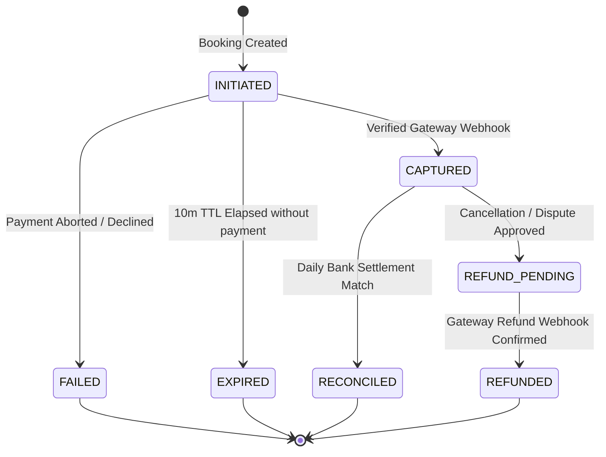

# Bidar Connect — Payment Architecture & Settlement Workflow

**Document Version:** 1.0.0  
**Status:** Approved Technical Specification  
**Scope:** Payment collection, gateway evaluation, webhook verification, idempotent reconciliation, and dispute refunds.

---

## 1. Overview & Business Model Alignment

Bidar Connect operates on a **Centralized Platform Collection Model**:
1. Passengers pay the company's merchant account directly at the time of booking.
2. The platform retains its configured commission revenue.
3. The platform disburses the net eligible trip share to the vehicle driver upon successful journey completion.

Direct driver-passenger cash payments or personal driver UPI QRs are strictly excluded from the system architecture.

```
┌─────────────┐       UPI / Card / NetBanking       ┌────────────────────────┐
│  Passenger  │ ─────────────────────────────────►  │ Bidar Connect Escrow / │
└─────────────┘                                     │ Company Merchant Acct  │
                                                    └───────────┬────────────┘
                                                                │
                                    ┌───────────────────────────┴───────────────────────────┐
                                    ▼                                                       ▼
                      ┌───────────────────────────┐                           ┌───────────────────────────┐
                      │  Platform Commission (C)  │                           │   Driver Payable Balance  │
                      │ (e.g. ₹10 - ₹20 per seat) │                           │  (e.g. ₹300 per seat net) │
                      └───────────────────────────┘                           └─────────────┬─────────────┘
                                                                                            │
                                                                       Automated Payout API │ (Post-Journey)
                                                                                            ▼
                                                                                      ┌───────────┐
                                                                                      │  Driver   │
                                                                                      └───────────┘
```

---

## 2. Payment Gateway Evaluation & Selection Matrix

To operate legally and efficiently in India, we evaluate leading payment aggregators against our marketplace requirements:

| Feature / Criteria | Razorpay (Route / Payouts) | Cashfree Payments & Payouts | PhonePe Payment Gateway |
| :--- | :--- | :--- | :--- |
| **Payment Collection (UPI/Cards)** | Excellent (Industry standard, 99.9% uptime) | Excellent (High UPI intent conversion) | Excellent (Native PhonePe app switch) |
| **Automated Driver Payouts** | RazorpayX Payouts (Requires corporate current acct) | Cashfree Payouts (Instant 24x7 IMPS/UPI) | Limited marketplace payout features |
| **Marketplace Split / Escrow** | Supported via Razorpay Route | Supported via Cashfree Marketplace | Complex / Manual escrow setup |
| **Webhook Security** | HMAC SHA-256 with secret key | HMAC SHA-256 with signature header | Cryptographic verification |
| **Integration Complexity** | Low (Well-maintained Python SDKs) | Low (Clean REST API & Webhook logs) | Medium |
| **Initial Stance** | **Recommended Primary** (or Cashfree) | **Recommended Secondary** | Backup |

*Decision:* The backend integration architecture is designed with a provider-agnostic adapter interface (`PaymentGatewayAdapter`), allowing seamless switching between Razorpay and Cashfree without touching domain business logic.

---

## 3. Detailed Payment State Machine & Transitions

The payment lifecycle is isolated from booking status to ensure financial accuracy:



### State Definitions
- `INITIATED`: Payment order generated with the payment provider. Booking holds temporary seat inventory.
- `CAPTURED`: Funds successfully debited from passenger and credited to platform merchant account, verified by signed webhook.
- `FAILED`: Passenger bank declined, insufficient funds, or gateway gateway error.
- `EXPIRED`: 10-minute payment window closed without capture; reserved seats are released back to inventory.
- `RECONCILED`: Transaction verified against gateway settlement ledger and bank statements.
- `REFUND_PENDING`: Legitimate cancellation initiated; refund instruction dispatched to payment gateway.
- `REFUNDED`: Payment gateway confirmed credit back to passenger's original payment source.

---

## 4. Webhook Security & Idempotent Verification

Under no circumstance will client-side redirect query parameters (e.g. `callback?status=success`) be trusted to finalize a booking.

### Webhook Verification Algorithm
1. **Raw Body Retention:** FastAPI extracts the exact raw request body bytes before JSON deserialization.
2. **HMAC Signature Check:**
   $$\text{Computed Signature} = \text{HMAC-SHA256}(\text{Raw Body}, \text{WEBHOOK\_SECRET})$$
   The backend executes a constant-time comparison (`hmac.compare_digest`) between the computed signature and the `X-Razorpay-Signature` (or `x-webhook-signature`) HTTP header.
3. **Idempotency Deduplication:** The backend checks the `payment_attempts` table for the incoming `gateway_payment_id`. If already processed, it returns an HTTP `200 OK` immediately without re-processing.
4. **Atomic Booking Confirmation:**
   - In a single database transaction, `payments.status` transitions to `CAPTURED`, `bookings.status` transitions to `CONFIRMED`, and the immutable `ledger_entries` records are created.

---

## 5. Dispute Handling & Reconciliation Engine

### 5.1 Automated Reconciliation Job
A daily automated cron job runs at 02:00 AM IST:
1. Calls the payment gateway's Settlements API for $T-1$ transactions.
2. Matches gateway transaction IDs against local `payments` records.
3. Flags discrepancies (e.g. captured on gateway but failed in webhook delivery) for immediate administrator triage.

### 5.2 Dispute & Chargeback Flow
- If a passenger raises an unauthorized transaction dispute with their bank:
  1. Gateway webhook emits `payment.dispute.created`.
  2. The system flags the associated booking and places a hold on any unsettled driver payout.
  3. Admin portal receives an alert to review trip logs, GPS track records, and passenger boarding confirmation before submitting evidence to the bank.

